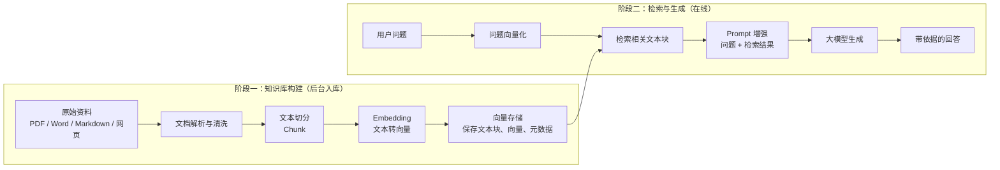
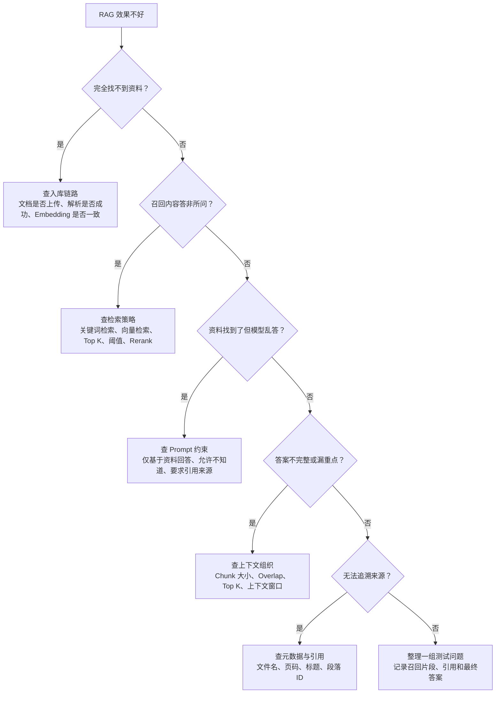

# RAG 学习笔记

本文从概念到工程实现介绍 RAG，示例采用企业人事制度问答场景。

阅读顺序：**RAG 基本流程 → 向量化 → 向量数据库 → Embedding 模型 → 与 Chat 模型的区别 → Java/Python 框架 → 当前项目落地与评测**。

## 1、RAG 的理解

### 1.1 什么是 RAG

RAG（Retrieval-Augmented Generation，检索增强生成）是一种把 **信息检索** 与 **大模型生成** 结合起来的应用架构。

它的核心思路并不复杂：

1. 用户先提问。
2. 系统先去外部知识源里找相关资料。
3. 把“问题 + 资料”一起发给大模型。
4. 由大模型基于这些资料生成答案。

RAG 的重点不是“重新训练模型”，而是**在运行时给模型补充它当前需要的上下文**。入门阶段先记住：

> **RAG = 先查资料，再回答问题。**

再说得更工程化一点：

- **Retrieval（检索）**：先找到和问题最相关的资料片段。
- **Augmented（增强）**：把检索到的资料拼进当前 Prompt 或消息上下文。
- **Generation（生成）**：让大模型基于这些资料生成最终答案。

所以，RAG 常被形容成“让模型开卷答题”：通过检索外部资料，为模型补充当前问题所需的上下文。当前项目的文档入库和问答过程都不会更新模型参数，更新知识主要靠更新资料与索引。

但“不改模型参数”不是 RAG 的定义性限制。RAG 也可以与检索模型微调、生成模型微调或联合训练结合使用；是否训练模型，取决于具体方案。

### 1.2 为什么需要 RAG

第一次接触知识库时，很多人会把 RAG 当成更高级的聊天技巧。这个理解不准确。RAG 出现的根本原因，是大模型单独使用时天然有几类限制，而这些限制在真实项目里很常见。

常见问题有三类：

- **知识冻结**：模型训练完成后，知识并不会自动随现实世界更新。
- **私有知识缺失**：企业制度、内部文档、项目资料、课程讲义这类内容，模型训练时通常没见过。
- **幻觉与不可追溯**：模型没把握时容易“猜一个像样答案”，而且很难告诉你依据来自哪里。

可以从两个角度理解这件事。

**第一，时间维度。**
随着模型规模增大，训练成本和周期也更高，因此大模型不可能天天重新训练。于是“最新信息、刚变更的信息、实时更新的信息”天然不是它的强项。

**第二，数据来源维度。**
大模型主要学到的是公开语料，而企业内部资料、个人笔记、项目规范、客户材料、课程总结，往往根本不在训练范围内。你直接问模型，它要么不知道，要么半猜半答。

**举例 1：**

随着 LLM 规模扩大，训练成本与周期相应增加。因此，包含最新信息的数据难以融入模型训练过程，无法及时反映最新的信息或动态变化，导致 LLM 难以应对诸如“请推荐当前热门影片”等时间敏感性问题。

**举例 2：**

大型语言模型（LLM）的训练依赖于网络上`海量公开的静态数据`，而某些`特定领域`（如企业内部资料、专有技术文档等）的数据通常不会作为公开的训练数据，导致模型在面对这些领域的查询时，可能因缺乏足够的信息而生成不准确甚至虚构的回复。

RAG 的价值就在这里：它不要求模型“自己就知道”，而是让系统在回答前先去你的资料里找证据。

**解决方案：**

为了解决这一问题，RAG 技术从外部知识源中检索相关资料，再将资料加入模型上下文。检索可以采用关键词检索、向量检索、SQL 查询、搜索引擎或业务 API，不要求必须使用 Embedding 或向量数据库。

本项目采用文档的稠密向量检索方案，包含文档加载、清洗、切块、Embedding、向量存储、检索、Prompt 组装和最终生成。这是一种常见实现，不能把其中每一步都视为所有 RAG 系统的必需步骤。

**举例 1：**

LLM 在考试的时候面对陌生的领域，答复能力有限，然后就准备放飞自我了，而此时 RAG 给了一些提示和思路，让 LLM 懂了开始往这个提示的方向做，最终考试的正确率从 60%到了 90%！

这里的百分比用于说明思路，不是本项目的测试结果，也不代表使用 RAG 就能获得固定幅度的提升。


**举例 2：**


放到真实项目里，大致是：

- 公司有制度、产品说明、FAQ、接口文档；
- 模型自己并不知道这些资料；
- 但当用户提问时，系统先去资料里找最相关的部分；
- 然后让模型基于这些资料回答。

这样回答会更像“有依据地作答”，而不是“靠模型印象发挥”。

### 1.3 执行流程

理解本项目采用的文档向量 RAG，可以把流程分成**两个阶段**：文档入库和检索生成。

第一阶段是 **知识库构建**，面向的是原始资料；第二阶段是 **检索与答案生成**，面向的是用户提问。其他 RAG 方案可以直接检索已有数据库或外部服务，不一定需要自行构建文档向量库。




**流程说明：**

整张图分为**两个阶段**：上方是**知识库构建**，下方是**查询与答案生成**。它做的事情是：先把本地文档变成一个可检索的知识库，再在用户提问时动态查资料，并把资料增强进模型输入。

| 步骤                       | 英文名              | 中文名         | 在做什么                                                     |
| -------------------------- | ------------------- | -------------- | ------------------------------------------------------------ |
| **阶段一：知识库构建**     |                     |                |                                                              |
| 1                          | Local Documents     | 本地文档       | 流程起点：你的 PDF、Word、Markdown、TXT 等原始文件，是私有知识库的数据来源。 |
| 2                          | Unstructured Loader | 非结构化加载器 | 读取并解析各种格式的本地文档，从中抽出纯文本，统一成后续可处理的格式。 |
| 3                          | Text                | 文本           | 加载器产出的纯文本内容。                                     |
| 4                          | Text Splitter       | 文本分割器     | 把长文本按规则切成小块，便于嵌入和放入 LLM 上下文。          |
| 5                          | Text Chunks         | 文本块         | 分割后得到的一段段文本，是后续嵌入和检索的基本单位。         |
| 6                          | Embedding           | 嵌入           | 用嵌入模型把每个文本块转成向量。语义相近的块，向量距离也更近。 |
| 7                          | VectorStore         | 向量存储       | 把文本块的向量、原文和元数据存入向量数据库，支持后续按相似度检索。 |
| **阶段二：查询与答案生成** |                     |                |                                                              |
| 8                          | Query               | 查询           | 用户用自然语言提出的问题或请求。                             |
| 9                          | Embedding           | 嵌入           | 用与文档编码兼容的方案把查询转成向量；本项目两侧均使用智普 embedding-3。 |
| 10                         | Query Vector        | 查询向量       | 用户查询的向量表示。用它去向量库里找最相关的文档块。         |
| 11                         | Vector Similarity   | 向量相似度     | 在向量存储中做相似度搜索，找出与问题最接近的文本块。         |
| 12                         | Related Text Chunks | 相关文本块     | 检索得到的文本片段，是回答问题时最关键的依据。               |
| 13                         | Prompt Template     | 提示模板       | 把“用户问题 + 检索结果”组装成一段结构化输入。这里对应 RAG 里的“增强”。 |
| 14                         | Prompt              | 提示           | 最终送入大模型的内容。                                       |
| 15                         | LLM                 | 大语言模型     | 基于检索结果和用户问题生成答案。这里对应 RAG 里的“生成”。    |
| 16                         | Answer              | 答案           | 模型基于检索到的资料给出的最终回答。                         |


> 在上述文档向量检索方案中，**检索**对应第 9 ～ 11 步（查询嵌入 → 查询向量 → 向量相似度搜索）；**增强**对应第 13 步（把检索结果注入到提示词 / 消息上下文）；**生成**对应第 15 步（LLM 输出答案）。

> **你可能会问：** 为什么文档和问题的编码方案必须兼容？可以把它理解为两侧需要使用相互匹配的“语义坐标系”。本项目两侧统一使用智普 embedding-3，并保持输出维度与输入约定一致。某些检索方案使用配套训练的查询编码器和文档编码器，两者可以不同，但输出空间必须兼容。不能随意混用不兼容的模型，仅维度相同也不够；详见第 2.6 节。

理解这张图时，还建议先记住四个最容易混的词：

- **知识库**：承载外部知识的整体容器，可能包含文档、分块、向量、元数据、检索配置等。
- **向量库**：知识库内部用于做相似度检索的存储组件，不等于整个知识库。
- **Embedding**：把文本变成向量的模型或过程。
- **Prompt 增强**：把检索结果交给模型的那一步。

继续阅读[项目学习指南](enterprise-rag-assistant/docs/learning-guide.md)时，可以把这些步骤映射到具体的代码对象。不同框架的名称有所不同，例如：

- 文档 -> `Document`
- 文本分割 -> `TextSplitter / TextChunker`
- 向量化 -> `EmbeddingModel / Embeddings`
- 检索 -> `Retriever`
- 增强输入 -> `PromptTemplate / ChatPromptTemplate`

**强调一下难点的步骤（蓝色部分）：**


这张图提醒的是：RAG 最难的地方通常不在“上传文件”本身，而在这些环节是否做得合理：

- 文档有没有被正确解析
- 文本是不是切得太碎或太大
- Embedding 模型是否合适
- 检索出来的内容是否真的相关
- 拼给模型的上下文里有没有太多噪音

RAG 不是“有知识库就一定答得好”，而是“知识库链路质量越高，回答越稳”。

### 1.4 RAG 工程质量框架

理解流程之后，再看一个更贴近真实项目的问题：**为什么同样叫知识库，有的回答很稳，有的却经常胡说？**

可以用这个公式做排查：**RAG 效果 = 文档质量 x 解析质量 x 切分质量 x 检索质量 x 重排质量 x Prompt 组织质量 x 生成模型质量 x 评测闭环**

这里的乘号表示：只要某个环节特别差，整体效果就会被明显拉低。

知识库答不准时，不要一上来就怪模型。可以先看现象，再往回查：



---

## 2、向量化：文字怎样变成可检索的数字

### 2.1 什么是向量

向量可以先理解为一个有固定长度的数字列表。例如：

```text
一段文字：员工请年假需要提前三个工作日申请。
向量表示：[0.12, -0.35, 0.08, ...]
```

上面的数字只用于示意，不是真实模型输出。真实文本向量通常包含数百到数千个浮点数。列表包含多少个数，就称为多少“维”。例如2048维，就是一段文字对应2048个数。

在语义检索中，我们希望：表达相关意思的问题和资料，在向量空间中更接近。例如，“酒店报销最高多少”和“差旅住宿费用上限”的文字不完全相同，但语义相关，合适的 Embedding 模型可以把它们映射到便于匹配的位置。

每一维通常不是人工定义的“工资”“休假”“交通”等业务字段，而是模型通过训练学到的分布式表示。不能直接把某一维解释成一个具体制度属性，也不能从向量中直接读出“住宿上限600元”。

### 2.2 什么是向量化与 Embedding

**向量化**是把数据转换为数值向量的过程；**Embedding**是其中一类通过模型学习表示的方法。本笔记讨论的主要是文本的稠密语义 Embedding。

需要区分三个词：

| 术语 | 含义 | 例子 |
|---|---|---|
| Embedding 模型 | 负责转换的模型 | 智普 embedding-3、BGE、Qwen3-Embedding |
| Embedding 调用 | 将一批文本交给模型的过程 | 向智普接口发送文本块 |
| Embedding 向量 | 调用后返回的数值表示 | 一个2048维浮点数组 |

向量化不等于重新训练大模型，也不等于把文档转换为摘要。文本、图片和音频都可以有向量表示，但需要选择支持对应输入及检索任务的模型，不能假设所有向量天然可以互相比对。

### 2.3 为什么文档和问题都要向量化

建库时，系统将文档拆成文本块，为每个块生成向量。提问时，系统将问题也转成向量，再寻找与问题向量相近的文本块。

```text
建库：住宿报销制度 → 文本块 → 文档向量 → 保存到向量库
提问：上海出差能报多少钱？ → 问题向量 → 检索相关制度块
```

检索返回后，交给 Chat 模型的是**原文片段及来源信息**，而不是让 Chat 模型直接阅读浮点数组。只保存向量、不保留原文或原文引用，通常不足以完成可追溯的 RAG。

### 2.4 怎样判断向量相似

常见的比较方式有：

| 方法 | 直观含义 | 常见排序方向 |
|---|---|---|
| 余弦相似度 Cosine Similarity | 比较向量方向是否接近 | 相似度越大通常越相关 |
| 点积 Dot Product | 综合向量方向与长度计算匹配程度 | 点积越大通常排名越前 |
| 欧氏距离 Euclidean Distance | 比较两个向量端点的距离 | 距离越小通常越接近 |

余弦相似度的公式为：`cos(a, b) = dot(a, b) / (norm(a) × norm(b))`。当两个向量都经过 L2 归一化后，点积与余弦相似度等价；未归一化时不能随意混用。

应该采用模型推荐的度量方式，并让向量库配置与之匹配。不同数据库和框架可能把原始距离转换为返回分数，因此阈值不能不经验证就跨实现照搬。

**相似度0.9不是“回答正确率90%”。** 它只反映特定模型和度量方式下的匹配分数；旧制度、错误金额、无权限内容也可能与问题非常相似。

### 2.5 分块、维度和批次的区别

| 参数 | 控制什么 | 当前项目示例 |
|---|---|---|
| 分块长度 chunk-size | 一段文本包含多少内容 | 600个 Unicode 码点 |
| 重叠长度 chunk-overlap | 相邻块共享多少上下文 | 100个码点 |
| 向量维度 dimensions | 每个块的向量包含多少个数 | 2048维 |
| 批次大小 embedding-batch-size | 业务层每组处理多少块 | 16块 |
| Top K | 一次检索最多取多少候选块 | 默认5块 |

这几个参数互相不能替代。把批次大小从16改为32，不会把向量从2048维改成4096维；把 Top K 改为10，也不会让上传时多切出一倍的块。

块太小可能丢失上下文，块太大可能混入多个主题或超过模型输入上限。维度越高，向量存储和计算成本通常越高，但检索效果不一定更好。模型的输入上限往往按 token 计算，不能把汉字数、Java 字符数与 token 数当成同一单位。

### 2.6 为什么换模型通常需要重建索引

文档和查询必须遵守一套一致、兼容的检索编码方案，包括配套的模型与版本、匹配的输出维度、归一化方式，以及各自要求的 query/document 输入格式。这不意味着两侧的编码器或输入格式必须完全相同。

- 同样是2048维，不代表两个模型生成的向量可以互相比较。
- 有些模型要求问题加 `query:`、文档加 `passage:`，或者使用不同的任务类型参数，应按该模型的约定处理。
- 某些检索模型采用配套训练的查询编码器和文档编码器，它们可以不同，但必须是经过设计、处于兼容空间中的配套组件，不能任意混搭。

因此，两侧需要的是**一套一致、兼容的检索编码方案**。更换为与旧文档向量不兼容的 Embedding 模型或维度时，应创建新集合、重新向量化文档、验证召回结果，再切换查询。只把查询侧改成不兼容的模型而继续搜索旧向量，会造成检索问题。

向量化也不是加密。调用云端 Embedding 服务时，待编码的文本会发送给该服务；原文件保存在哪里，与模型请求发送了哪些文字，是两个不同的问题。

## 3、向量数据库：向量生成之后放在哪里

### 3.1 向量数据库负责什么

Embedding 模型负责“生成向量”，向量数据库负责“保存和检索向量”。两者是不同组件。

常见能力包括：

- 保存向量、文本内容或原文引用，以及文件名、租户、知识库、版本等元数据。
- 按相似度寻找邻近向量，返回 Top K 候选。
- 结合元数据条件过滤，例如只检索当前用户有权限的知识库。
- 支持索引构建、增删改、持久化、备份及运行监控，具体能力因产品而异。

专用向量数据库通常不负责解析 PDF，也不会天然知道用户权限、制度生效时间或 MySQL 中的文档处理状态。这些业务约束需要应用通过元数据、过滤条件和状态管理接入。

### 3.2 一条向量记录包含什么

以当前项目 Qdrant 中的一个文本块为例，逻辑上可以表示为：

```json
{
  "id": "稳定的文本块UUID",
  "vector": [0.12, -0.35, 0.08],
  "payload": {
    "doc_content": "北京、上海、深圳住宿上限为600元/人/晚。",
    "tenant_id": "demo-company",
    "knowledge_base_id": "知识库UUID",
    "document_id": "文档UUID",
    "filename": "差旅与费用报销管理制度.pdf",
    "chunk_index": 2,
    "start_offset": 1000,
    "end_offset": 1600
  }
}
```

示例向量仅用3个数说明结构，当前项目实际默认是2048维；偏移字段也仅为示意，不与此处的短句长度对应。`doc_content` 是当前 Spring AI Qdrant 实现保存块原文的字段名，不是所有向量库统一要求的标准字段。

租户、知识库和文档 ID 用于隔离检索范围，块原文用于构造模型上下文，文件名和块位置用于来源展示。元数据不是可有可无的备注，它往往决定检索结果能否安全、准确地用于业务。

### 3.3 为什么不直接扫描全部向量

少量数据可以计算问题向量与每条文档向量的距离，得到精确近邻结果。但数据规模增大后，逐条扫描会增加耗时。

向量检索引擎常使用近似最近邻索引（ANN），如 HNSW，在召回质量、延迟、内存和构建成本之间做权衡。ANN 的“近似”表示结果不保证与全量精确计算完全一致；索引参数、过滤条件和数据分布都需要通过测试调优。

过滤尤其重要：如果先从全公司的数据取 Top 5，再删除无权限结果，可能最终没有任何可用片段，即使本部门存在相关资料。应尽量在检索过程中限定授权范围，同时在返回前再次校验业务状态。

### 3.4 常见向量存储的优缺点与适用场景

以下用于理解产品定位，不是性能排名。吞吐、成本和召回率取决于版本、部署方式、向量规模与索引参数。

| 方案 | 主要优点 | 主要代价或边界 | 适用场景 |
|---|---|---|---|
| Qdrant | 专注向量检索，元数据过滤能力较完整，有 REST/gRPC 和 Java/Python 客户端 | 独立部署时需维护额外服务，并处理与业务数据库的数据一致性 | 已有 MySQL，希望增加独立向量检索服务；适合当前项目 |
| Milvus | 面向向量检索，有适合较大规模数据和分布式场景的部署方案 | 生产部署涉及更多资源规划和运维，轻量方案与分布式方案复杂度不同 | 向量规模、吞吐和扩展需求较高的检索系统 |
| PostgreSQL + pgvector | SQL、事务、关系数据和向量查询可以放在同一数据库中 | 需要 PostgreSQL；近邻索引、业务过滤和资源竞争仍需调优，不保证一个数据库就解决所有性能问题 | 原本已用 PostgreSQL，或希望在 SQL 内组合业务过滤与向量检索 |
| Elasticsearch / OpenSearch | 已有全文检索、过滤和运维生态，便于组合关键词与向量检索 | 集群资源成本及检索配置复杂度较高，两种产品的具体接口与能力有差异 | 已有搜索集群，重视 BM25、关键词和语义混合检索 |
| Chroma | Python 入门方便，可选择本地持久化或服务模式，适合快速验证 | 企业级权限、备份、规模和部署需求要按实际版本及方案评估 | 学习、原型、小型知识库和实验 |
| FAISS | 高效的向量索引库，便于 Python 检索实验，部分索引支持 GPU | 它是库而不是完整数据库；文档存储、元数据过滤、并发写入和持久化管理通常需自己组合 | 本地算法验证、研究、离线检索或自建检索服务 |

不要因为业务数据库使用 MySQL，就必须把向量也塞进 MySQL。MySQL 不同版本、发行形态和托管服务的向量能力存在差异，应确认实际可用的字段类型、索引、过滤与检索接口；仅能用 JSON/BLOB 保存数组，不等于已经具备高效向量检索能力。

### 3.5 当前项目为什么采用 MySQL + Qdrant

| 存储 | 负责的数据 | 更新时需要注意什么 |
|---|---|---|
| MySQL | 用户、知识库、成员权限、原文件信息、文档状态和审计 | 是业务事实来源，决定谁能读、哪些文件已就绪 |
| Qdrant | 文本块向量、块原文和检索元数据 | 是可重建索引，部分写入成功不代表业务已发布 |
| 文件存储 | 原始 PDF、Word、TXT、Markdown | 保留原件用于下载、重试和重新解析 |

三个存储之间没有自动形成一个共同事务。因此项目使用 `PENDING → INDEXING → READY` 状态、确定性块 ID、失败重试和删除补偿来协调。只有 MySQL 标记为 READY 的文档，才能进入正常问答检索。

## 4、Embedding 模型：怎样选择文本编码器

### 4.1 模型实际输入和输出

典型文本 Embedding 调用可以理解为：

```text
输入：一条或多条文本
模型：针对检索任务训练的文本编码器
输出：每条文本对应一个固定维度向量
```

向量维度固定是指同一套输出配置下，每条文本产生相同长度的向量，而不是所有模型都有同一维度。文本变长不会让该条向量自动变长；超过输入上限时，可能报错或按服务规则截断，应用应避免依赖未经确认的截断行为。

用于 RAG 的模型通常重视“问题能否匹配相关段落”，不要求段落与问题字面完全相同。短句相似度、长文检索、中文问答、代码搜索等任务的需求不同，不能只凭模型名字或参数量决定效果。

### 4.2 云端服务与自行部署

| 方式 | 优点 | 需要承担的工作 |
|---|---|---|
| 云端 Embedding API | 接入快，无需自行维护推理设备，便于 Java/Python 系统调用 | 网络、调用配额、计费、数据发送范围及供应商故障处理 |
| 自行部署开放权重模型 | 可控制部署位置、模型版本和推理策略 | 设备资源、模型加载、批处理、监控、升级、容量及安全维护；商用条件需查看模型许可证 |

“开放权重”不等于一定可以免费商用，也不等于不需要计算资源。自行部署可以使用独立推理服务，Java 业务通过 HTTP 调用，并不要求把 Python 模型代码嵌入 Spring Boot 进程。

### 4.3 常见模型示例

| 模型或系列 | 主要特点 | 适合怎样评估 |
|---|---|---|
| 智普 embedding-3 | 云端文本向量服务，当前项目采用；输出维度可按支持的配置选择 | 用中文制度问题测试召回，检查维度、批量与输入上限 |
| BGE-M3 | 多语言模型，提供稠密、稀疏及多向量表示能力 | 适合评估多语言、长文本和混合检索；普通框架适配器不一定暴露所有输出能力 |
| BGE 中文模型，如 bge-large-zh-v1.5 | 面向中文语义表示与检索的常用开放权重选择 | 适合评估中文资料，按模型说明处理查询指令和输入格式 |
| multilingual-e5 系列 | 多语言检索编码器 | 按模型要求区分 query/passage 输入，不能省略约定后直接比较效果 |
| Qwen3-Embedding 系列 | 多语言与指令感知的文本 Embedding 模型系列 | 结合所选模型的任务指令、输入长度、维度和部署资源进行评测 |

这些模型不是互相可直接替换的“同接口参数”。即使通过同一种 HTTP 格式调用，也必须确认模型名、输出维度、输入格式、许可证以及框架能否正确解析响应。

### 4.4 选型时优先验证什么

1. **业务语言和任务**：是否覆盖中文、英文缩写、岗位名称、产品型号等实际问题。
2. **召回质量**：正确制度是否进入 Top K；不要仅看公开榜单或单条相似度。
3. **输入约定**：query/document 是否需要前缀、指令或不同任务类型。
4. **长度与批量限制**：按 token 还是字符限制，单批允许多少条，长文本如何处理。
5. **维度与资源**：存储成本、计算延迟、网络传输量，以及向量库集合维度是否匹配。
6. **服务稳定性**：超时、限流、失败重试与可观测性是否满足业务需求。
7. **版本与重建成本**：能否固定模型版本，更换模型后如何重建和切换索引。

在当前工程中，智普 Embedding-3 默认使用2048维；应用每块600个码点、每组最多16块。智普文档给出的数组输入约束包括单条最多3072 tokens、每批最多64条，应以实际服务文档和返回结果为准。应用侧的码点长度并不保证任何文本都满足 token 限制。

## 5、Embedding 模型与 Chat 模型有什么区别

### 5.1 职责对比

| 对比项 | Embedding 模型 | Chat 模型 |
|---|---|---|
| 核心职责 | 把内容编码为便于相似度计算的向量 | 根据消息和上下文生成回答 |
| 典型输入 | 问题或文档块，可包含模型规定的任务指令 | system/user/assistant 等消息，及检索证据 |
| 典型输出 | 固定维度的浮点数组 | 自然语言、结构化内容或工具调用，取决于模型与配置 |
| RAG 中的作用 | 帮助找到相关资料 | 阅读已找到的资料并组织答案 |
| 调用时机 | 文档入库时；通常每次查询时也会调用 | 需要生成答案时调用，无证据时可直接拒答而不调用 |
| 主要评价指标 | Recall@K、排序质量、延迟与成本 | 答案正确性、依据一致性、引用、拒答及生成延迟 |
| 更换后的影响 | 通常需要重建文档向量，保证检索空间一致 | 通常不需要重建向量，但要重新验证提示词、上下文及输出契约 |
| 当前项目选择 | 智普 embedding-3 | DeepSeek 聊天模型 |

**Embedding 负责找资料，Chat 负责读资料、回答问题。** 它们可以属于不同厂商，只要应用正确对接输入输出；不要求智普向量必须交给智普 Chat 生成答案。

### 5.2 为什么不能直接用 Chat 回答替代向量

如果把每个文档块交给 Chat 模型，让它返回一段摘要，得到的仍然是文本，不是可直接用于向量距离计算的固定维度表示。摘要可以辅助检索或压缩上下文，但不能自动替代 Embedding 编码器。

同样，Chat 模型内部虽然也有隐藏状态或 token embedding，但聊天 API 通常不会提供一套经过检索验证、与文档库匹配的向量输出契约。不能仅凭“都是大模型”就把聊天接口当成文本 Embedding 接口。

也不要把 Embedding 生成的浮点数组直接拼进 Prompt，期待 Chat 模型从数字还原制度。正常 RAG 会用向量找回原文，再把原文作为证据交给 Chat。

### 5.3 用一个人事问题串起来

用户问：“普通岗位内推奖金分两次，各能拿多少钱？”

```text
1. 智普 Embedding：把问题编码成问题向量。
2. Qdrant：在有权限且已就绪的文档内检索，返回招聘奖励条款。
3. 应用：拿到“普通岗位5000元，第一次30%，第二次70%”的原文及来源。
4. DeepSeek：基于证据回答“第一次1500元，第二次3500元”，并标注来源。
```

如果检索阶段拿到的是差旅报销制度，换一个更强的 Chat 模型也不能保证答对内推奖金；如果正确条款已经召回但模型答错金额，则应重点检查上下文、计算与生成约束。

### 5.4 Reranker 又是什么

Reranker 是可选的重排模型：读取“问题 + 候选文本”，重新计算相关性并排序，通常放在初次检索之后、生成之前。

```text
Embedding 检索 Top 20 → Reranker 排序 → 选择更相关的片段 → Chat 生成
```

它通常不替代向量库，也不负责生成最终答案。它的分数与向量相似度不一定采用相同尺度，不能共用未经验证的阈值。当前学习项目尚未接入 Reranker。

## 6、RAG 框架：Java 和 Python 有哪些选择

### 6.1 先分清技术层次

| 层次 | 解决的问题 | 示例 |
|---|---|---|
| 应用框架 | HTTP 接口、依赖注入、配置、业务事务 | Spring Boot、FastAPI |
| RAG / AI 集成框架 | 对接模型、文档加载、检索、上下文和生成 | Spring AI、LangChain4j、LangChain、LlamaIndex、Haystack |
| 文件解析组件 | 从 PDF/Word/图片中提取内容 | Apache Tika、PDF 解析库、OCR 服务 |
| 模型或模型服务 | 编码文本、重排或生成回答 | Embedding、Reranker、Chat |
| 检索存储 | 保存索引并执行查询 | Qdrant、Milvus、pgvector 等 |

Spring Boot 不是 Embedding 模型，LangChain4j 不是向量数据库，Qdrant 也不是完整 RAG 框架。框架可以替你组织调用，但不会自动补齐权限、文档状态、数据一致性和质量评测。

### 6.2 Java 方向

| 框架 | 常见概念与能力 | 优点 | 适用场景及注意事项 |
|---|---|---|---|
| Spring AI | ChatModel、EmbeddingModel、VectorStore、Document、ChatClient、Advisor | 贴合 Spring Boot 的配置、依赖注入和监控体系，便于复用既有业务工程 | 适合已有 Spring 技术栈；需明确不同模型供应商的分工，RAG 可显式编排，也可使用相关 Advisor |
| LangChain4j | ChatModel、EmbeddingModel、EmbeddingStore、ContentRetriever、AI Services | Java 风格的模型与检索抽象，AI Services 可通过接口组织模型调用 | 适合 Java 应用集成模型与 RAG；不同集成模块的接口、版本和能力需匹配 |

两者通常择一作为主要 AI 集成层即可，不必为了“功能完整”同时引入。它们都可以配合 Spring Boot、MySQL 和 Qdrant 使用；读取权限和处理状态仍由自己的业务代码管理。

当前项目选择 **Spring Boot + Spring AI**，并显式编写检索与生成步骤，方便学习。代码关系为：

```text
DocumentWorker
  → DocumentTextExtractor
  → TextChunker
  → KnowledgeVectorIndex
    → Spring AI VectorStore
      → 智普 EmbeddingModel + Qdrant
```

当前项目的 `VectorStore.add()` 内部已经会调用 EmbeddingModel，再写入 Qdrant；业务层不要为了“先向量化”又额外调用一次模型，否则可能重复计算和计费。其他框架或底层客户端的写入接口可能要求显式提供向量，需按具体接口理解，不能一概而论。

### 6.3 Python 方向

| 框架 | 侧重点 | 优点 | 适用场景及注意事项 |
|---|---|---|---|
| LangChain | 模型、工具、检索组件与应用编排 | 集成生态较广，适合组合检索、工具和生成流程 | 适合多组件 AI 应用；核心包与各供应商集成包需按当前文档组合，不宜直接照搬旧教程接口 |
| LlamaIndex | 文档摄取、索引、检索与查询引擎 | 以外部数据和知识检索为中心，便于构建文档问答原型 | 适合知识库、文档结构和多种检索策略实验；需理解索引与存储组件各自维护哪些数据 |
| Haystack | 显式组件和 Pipeline | 数据流及处理步骤较直观，便于组织可测试的检索生成管道 | 适合希望清楚控制处理链路的系统；应区分当前主版本与旧版教程 |

Python 往往更便于直接使用开放权重模型、GPU 推理和评测工具，但不意味着必须把已有 Java 业务系统重写。常见做法是 Java 管理权限、文档和业务 API，Python 提供独立的 OCR、Embedding、Reranker 或评测服务。

如果模型本来就是通过云端 HTTP API 调用，Java 与 Python 都能完成相同基本链路，团队熟悉程度、现有部署和长期维护成本通常比语言本身更值得优先考虑。

### 6.4 框架与可视化平台不是一回事

Dify、RAGFlow 等平台可用于搭建知识库和工作流，通常提供管理界面、服务部署及预置流程。它们与 Spring AI、LangChain4j 这类嵌入业务工程的库不是同一层次的选择。

希望快速配置和演示，可以评估平台；希望学习或控制每一步 Java 代码，可以选择框架显式实现。平台支持哪些解析器、模型、权限粒度、插件和接口，需要按实际版本验证，不应仅凭“支持 RAG”就假设满足全部企业需求。

## 7、把这些概念放回当前项目

### 7.1 各组件的职责

| 组件 | 当前职责 | 不应混淆的边界 |
|---|---|---|
| Spring Boot | 后端接口、认证会话、调度、依赖注入和业务组织 | 不直接决定语义检索质量 |
| Apache Tika | 提取 PDF、Word 的现有文字内容 | 当前没有启用扫描图片 OCR |
| TextChunker | 将清洗后的全文切成有重叠的小块 | 码点长度不是 token 长度 |
| Spring AI | 提供模型、向量存储抽象及供应商适配 | 不是模型厂商，也不自动替代业务权限 |
| 智普 embedding-3 | 为文档块和用户问题生成向量 | 不直接生成制度问答答案 |
| Qdrant | 保存向量、块原文及元数据，执行相似度检索 | 不充当用户、权限和任务状态的业务事实源 |
| MySQL | 保存用户、知识库、权限、文件信息和任务状态 | 当前没有承担向量相似度检索 |
| 本地文件存储 | 保存上传原件，支持下载和重新处理 | 原件落盘成功不等于索引完成 |
| DeepSeek | 阅读检索证据并生成回答 | 不会自动读取全部本地文件或全部 Qdrant 数据 |

### 7.2 两条链路分别调用哪些模型

```text
上传入库：
原文件 → 落盘、MySQL 登记 PENDING
       → Worker 领取并标记 INDEXING
       → 文字提取 → 文本分块
       → 智普 Embedding → Qdrant 写入
       → MySQL 标记 READY

用户提问：
问题 → 登录及知识库权限校验 → 获取 READY 文档 ID
     → 智普 Embedding → Qdrant 带权限范围检索
     → 再次检查权限和文档状态 → 整理证据
     → 有证据：DeepSeek 生成 → 返回答案与来源
     → 无证据：返回资料不足，不调用 DeepSeek
```

当前项目没有多轮会话检索记忆、OCR、Reranker 或混合检索。界面上能连续显示多次问答，不代表后端已经把历史聊天纳入当前问题理解。

### 7.3 为什么扫描 PDF 会失败

扫描 PDF 存的是图片，提取器可能得到空字符串。此时必须先进行 OCR，把图片中文字转换为可读取文本，才能继续分块和向量化。

```text
带文字层的 PDF → 提取文字 → 分块 → Embedding
纯扫描 PDF     → OCR 识别文字 → 分块 → Embedding
```

Embedding 不是 OCR，Chat 也不会因为配置了 API Key 就自动获得识别扫描 PDF 的能力。多模态模型可以用于构建另一种文档理解方案，但需要显式增加文件或图片输入与处理流程，不能视为当前文本链路的现成能力。

详细实现可对照[上传文档后端执行链路](enterprise-rag-assistant/docs/document-upload-flow.md)和[项目学习指南](enterprise-rag-assistant/docs/learning-guide.md)。

## 8、学习与测试时怎样定位问题

### 8.1 按顺序检查，不要一次调整所有参数

1. **先看提取文字**：金额、日期、表格和关键条件是否完整，有没有空白或乱码。
2. **再看分块结果**：一条制度的条件与结论是否被切散，来源位置能否追溯。
3. **检查向量契约**：模型、维度、输入约定、归一化与 collection 是否匹配。
4. **单独测试检索**：不调用 Chat 也能检查 Top K 是否包含正确依据。
5. **核对过滤与版本**：结果是否来自正确租户、知识库、有效版本和 READY 文档。
6. **再看生成**：是否把证据完整交给 Chat，是否遵守引用、拒答和计算要求。
7. **记录评测结果**：分别统计检索与生成的变化，每次优先调整一个因素。

### 8.2 三类问题分别测什么

| 测试类型 | 示例 | 检查重点 |
|---|---|---|
| 有明确依据 | “上海酒店住宿上限多少？” | 正确制度是否召回，答案是否保留元/人/晚等单位 |
| 需要组合或计算 | “普通岗位内推奖金5000元，首期30%，分别发多少？” | 条件是否齐全，计算是否正确，是否引用实际条款 |
| 当前资料没有依据 | “今年年终奖几个月？” | 是否说明资料不足，而不是调用模型常识编造 |

跨文档问题还应检查是否召回了全部必要证据；权限测试应验证未授权用户无法检索到内容，而不只是页面隐藏了按钮。

检索可以统计 Recall@K：标注的相关证据有多少进入前 K 个结果；生成可以检查答案正确性、与证据的一致性、引用准确性和合理拒答。评测时还应记录延迟、模型调用量和费用，不能只凭一次演示效果决定选型。

可直接使用项目中的[人事制度测试资料与问题清单](enterprise-rag-assistant/docs/examples/hr-test-data/测试问题与预期答案.md)。问题清单用于人工核对，不要作为知识资料一起上传，否则系统可能检索到现成答案而掩盖真实召回问题。

## 9、官方资料入口

以下链接用于进一步核对接口、安装方式及能力边界。本文不绑定“最新版”或固定价格，具体模型和框架能力以实际采用版本的文档为准。

| 类别 | 官方资料 |
|---|---|
| Java 框架 | [Spring AI](https://docs.spring.io/spring-ai/reference/) · [LangChain4j](https://docs.langchain4j.dev/) |
| Python 框架 | [LangChain](https://docs.langchain.com/) · [LlamaIndex](https://docs.llamaindex.ai/) · [Haystack](https://docs.haystack.deepset.ai/) |
| 向量存储 | [Qdrant](https://qdrant.tech/documentation/) · [Milvus](https://milvus.io/docs) · [pgvector](https://github.com/pgvector/pgvector) |
| 搜索与本地索引 | [Elasticsearch](https://www.elastic.co/docs) · [OpenSearch](https://docs.opensearch.org/) · [Chroma](https://docs.trychroma.com/) · [FAISS](https://github.com/facebookresearch/faiss) |
| Embedding | [智普 Embedding-3](https://docs.bigmodel.cn/cn/guide/models/embedding/embedding-3) · [BGE / FlagEmbedding](https://github.com/FlagOpen/FlagEmbedding) · [E5](https://github.com/microsoft/unilm/tree/master/e5) · [Qwen3-Embedding](https://github.com/QwenLM/Qwen3-Embedding) |
| Chat | [DeepSeek API](https://api-docs.deepseek.com/) |
