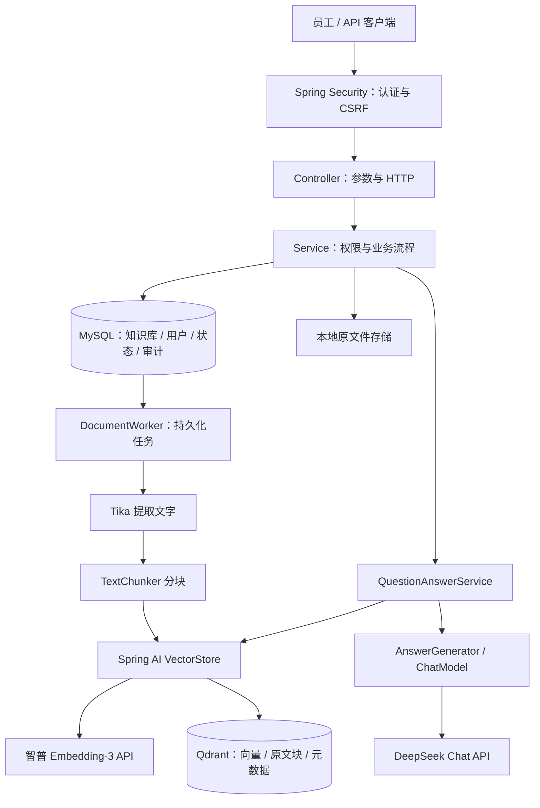

# 企业信息问答助手（Java RAG 学习工程）

后端工程位于项目根目录的 `backend/`，本文件集中保存后端使用说明。上传企业资料后，系统异步解析和向量化，在用户有权访问的知识库中检索，再让聊天模型基于检索证据回答，并返回原文件来源。

后端技术栈：**Java 21 + Spring Boot 3.5.16 + Spring AI 1.1.8 + MySQL 8.4 + Qdrant + Apache Tika + 智普 Embedding-3 + DeepSeek**。采用 Spring JDBC / JdbcClient，把 SQL 与状态变化写明白，便于学习。配套前端使用 **React + TypeScript + Vite**，位于 `frontend/`。

本项目是企业场景的学习起点，当前按**单应用实例**设计。它包含实际的权限和失败处理，但不等同于已经完成生产加固的企业产品。

## 已实现功能

- 知识库创建、列表，创建人管理，成员读取，授权与撤权。
- PDF、DOC、DOCX、UTF-8 TXT、Markdown 上传和受保护下载，单文件上限 20 MB。
- MySQL 持久化文档状态，后台解析、分块、Embedding、写入 Qdrant。
- 索引失败可重试，应用重启恢复中断任务，分批入库与确定性向量 ID。
- 按租户、知识库、READY 文档前置过滤检索，返回前再次检查撤权与删除。
- 带编号、文件名、块序号、相关性分数及原文片段的问答；无证据时不调用聊天模型。
- 异步删除向量与原文件，失败可重试；删除请求生效后，文档立即退出可检索集合。
- BCrypt 密码、浏览器 Cookie 会话与刷新恢复、脚本 HTTP Basic 认证、CSRF 防护与不含问题正文的访问审计。

## 1. 运行准备

### 前端功能演示

在 `frontend/` 目录执行 `npm ci`、`npm run dev`，然后打开 **http://127.0.0.1:5173**。需要 Node.js 22.12+。

登录页可以用后端账号连接真实服务，也可以选择“体验交互演示”，用虚构资料体验问答、上传、下载、文档重试/删除、知识库切换和成员授权。示例模式不会调用云模型，页面会持续标注。完整说明见[前端文档](frontend.md)。

需要 JDK **21**、Maven **3.6.3+**、Docker Compose，以及智普和 DeepSeek 两个平台的 API Key。Windows 脚本使用 PowerShell **7.2+**（`pwsh`）。

先检查 `java -version` 和 `mvn -version`：两者都应使用 JDK 21。Java 8 无法编译本项目。

默认模型：

| 用途 | 模型 | 说明 |
|---|---|---|
| 文本向量化 | 智普 `embedding-3` | 文档和问题使用同一模型，显式配置为 2048 维 |
| 回答生成 | DeepSeek `deepseek-flash` | 按当前官方文档选择默认模型，可通过 DEEPSEEK_CHAT_MODEL 修改 |

无需本地下载模型或 GPU。文档块和问题会发送到智普，问题与检索证据会发送到 DeepSeek。两个服务使用独立密钥和官方 HTTPS 地址；实际调用按各平台规则计费。

## 2. Windows 快速启动

以下启动及 Compose 命令在项目根目录（`compose.yaml` 所在目录）执行；Maven 构建命令在 `backend/` 中执行：

```powershell
# 仅首次执行：生成本地随机密码和 Qdrant API Key。已有 .env 时跳过此命令。
pwsh -File ./scripts/init-env.ps1

# 打开 .env，自行填写 ZHIPU_API_KEY 与 DEEPSEEK_API_KEY。
# 不要保留 <YOUR_...> 占位符；本地初始化脚本不能生成云服务密钥。

# 启动 MySQL 和 Qdrant。
docker compose up -d mysql qdrant

# 启动应用：脚本会读取项目的 .env。
pwsh -File ./scripts/run-local.ps1
```

如果系统默认 Java 是 8，可为该进程单独指定 JDK，不修改系统设置：

```powershell
pwsh -File ./scripts/run-local.ps1 -JavaHome 'D:\path\to\jdk-21'
```

首次启动由 Flyway 自动创建表，并用 `.env` 中的随机密码创建同一演示租户的 `alice` 和 `bob`。初始化不会覆盖已有用户密码；生产环境应关闭 `BOOTSTRAP_ENABLED` 并接入企业身份系统。

检查健康与完整演示：

```powershell
Invoke-RestMethod http://localhost:8080/actuator/health

# 自动完成：创建知识库 → 上传示例手册 → 等待 READY → 授权 bob → 提问。
pwsh -File ./scripts/demo.ps1
```

演示脚本会显示问答 JSON，并保留知识库和文档。重复运行会创建新的学习知识库。

**注意：** Compose 自动读取 `.env`，但直接执行 `mvn spring-boot:run` 不会。请用脚本，或在 IDE 的运行配置中设置对应环境变量。

## 3. 可选：全部使用 Docker

无需宿主机 JDK 或 Maven，但需要 Docker 和已填写两个云服务 API Key 的 `.env`。

```powershell
docker compose --profile app up -d --build app
docker compose logs -f app
```

一起启动前端：`docker compose --profile app up -d --build frontend`，打开 **http://localhost:8081**。前端 Nginx 代理后端 API，浏览器保持同源认证。

应用容器直接通过 HTTPS 访问智普和 DeepSeek，需保证容器可以访问对应域名。

端口都绑定到 `127.0.0.1`，默认 MySQL `3306`、Qdrant HTTP `6333`、Qdrant gRPC `6334`、应用 `8080`。端口冲突可修改 `.env` 对应字段。停止服务使用 `docker compose --profile app down`；**不要随意加 `-v`，它会删除学习数据卷。**

本机脚本会进入 `backend/` 启动后端，文件默认写入 `backend/data/files/`；应用容器的文件写入 `app-files` 数据卷。不要让这两种运行方式同时连接同一业务库，或在不迁移文件的情况下来回切换。直接运行 JAR 或在 IDE 启动时，也请将工作目录设为 `backend/` 并加载项目根目录 `.env`。Compose 的后端构建上下文为 `backend/`，不包含前端、文档或根目录密钥。

## 4. 架构与代码阅读顺序



推荐按下面的顺序阅读。Java 文件都在 `backend/src/main/java/com/example/ragassistant/` 下：

1. `web/ApiModels.java`：先看输入输出，知道项目能做什么。
2. `web/KnowledgeBaseController.java`：找到问答入口。
3. `service/QuestionAnswerService.java`：完整 RAG 主流程，尤其是权限、检索、上下文和来源。
4. `rag/KnowledgeVectorIndex.java`：理解 `VectorStore.add()` 与 `similaritySearch()`。
5. `service/DocumentService.java`、`service/DocumentWorker.java`：理解上传与后台处理为何分开。
6. `rag/DocumentTextExtractor.java`、`rag/TextChunker.java`：理解文档怎么变成可检索的小块。
7. `repository/DocumentRepository.java`：理解状态迁移、重试与条件更新。
8. `service/KnowledgeBaseService.java`、`config/SecurityConfig.java`：区分“你是谁”和“你能访问什么”。

更详细的学习说明在[学习指南](learning-guide.md)，接口说明在[接口文档](api.md)。测试资料位于 [examples/](examples/)，其中人事制度有 Markdown、TXT、DOCX 和带文字层的 PDF。

上传文件到索引就绪的逐方法调用过程、时序图和断点建议见[上传文档执行链路](document-upload-flow.md)。

## 5. 常用配置

| 配置 | 默认值 | 含义 |
|---|---|---|
| `DB_URL` / `DB_USERNAME` / `DB_PASSWORD` | localhost / rag / 必填 | 连接 MySQL；本地脚本根据 MYSQL_PORT 生成 URL |
| `QDRANT_HOST` / `QDRANT_GRPC_PORT` | localhost / 6334 | Java gRPC 客户端连接地址 |
| `QDRANT_API_KEY` | Compose 必填 | Qdrant 服务认证 |
| `ZHIPU_API_KEY` / `DEEPSEEK_API_KEY` | 必填 | 分别从智普、DeepSeek 平台获取 |
| `ZHIPU_BASE_URL` | https://open.bigmodel.cn/api/paas | Spring AI 会追加 /v4/embeddings，不要重复加路径 |
| `ZHIPU_EMBEDDING_DIMENSIONS` | 2048 | 官方 API 可选 256 / 512 / 1024 / 2048，变化时需更换集合并重建 |
| `DEEPSEEK_BASE_URL` | https://api.deepseek.com | Spring AI 会追加 /chat/completions |
| `DEEPSEEK_CHAT_MODEL` | deepseek-flash | 使用账户可访问的聊天模型名称 |
| `QDRANT_COLLECTION` | enterprise_knowledge_zhipu_embedding3_2048_v1 | 当前 Embedding 模型和维度对应的向量集合 |
| `STORAGE_ROOT` | ./data/files | 相对后端工作目录解析；本机脚本对应 backend/data/files/ |
| `app.rag.chunk-size` / `chunk-overlap` | 600 / 100 | 以 Unicode 码点计数的滑窗参数，不是 token 数 |
| `app.rag.top-k` / `similarity-threshold` | 5 / 0.45 | 召回数量 / 余弦相似度阈值，需根据实际样本调优 |
| `app.rag.max-context-characters` | 6000 | 参考资料总 UTF-16 长度上限，不是严格 token 预算 |

切换 **Embedding 模型或维度**时，即使新旧向量维度相同，也不能混用：创建新的 collection 并重新索引。当前项目没有全库重建 API，请删除旧文档记录并重新上传；重试 API 只接受失败文档，不是全库重建 API。切换聊天模型通常无需重建向量。

如果已有旧模型生成的数据：切换 collection 不会自动修改 MySQL 中的 READY 状态，也不会迁移原向量；必须重新上传才会在新集合里建立索引。原集合不会被程序自动删除，可核对迁移结果后再自行清理。

智普文档对 Embedding-3 数组输入规定单条最多 3072 tokens、每批最多 64 条。本项目默认每批 16 条、每块 600 个码点；字数不等于 token 数，特别长的问题或特殊文本仍可能触发供应商限制。调大分块参数时应一起评估此限制。新建集合时 Spring AI 会通过一次 Embedding 请求探测维度，因此首次启动也可能调用智普 API。

## 6. 验证工程

```powershell
# 从项目根目录进入独立后端工程。
cd backend

# 单元测试及云模型 HTTP 契约测试，不需要数据库或真实 API Key。
mvn -B -ntp test

# 完整验证：需 Docker，自动创建并销毁独立 MySQL / Qdrant 测试容器。
mvn -B -ntp -Pintegration verify
```

集成测试使用真实数据库、真实向量存储和 HTTP 安全过滤器，但模型是确定性测试替身。另有 `CloudModelConfigurationTest` 加载实际配置与真实 Spring AI 客户端，使用 HTTP 替身检查供应商选择、URL、独立鉴权、模型名、向量维度、原文输入和响应解析。这些测试不调用收费服务，**不验证真实模型的召回率、幻觉或回答质量**。填写真实 API Key 后可运行 `scripts/demo.ps1` 验证真实问答。

## 7. 当前边界与后续扩展

- **单应用实例**：任务恢复采用启动时重置处理中状态。多实例需要租约、分布式锁或 MQ，不能直接水平扩容。
- 文件系统与 MySQL/Qdrant 没有跨系统事务。正常异常有补偿和重试；进程恰好在保存文件与登记数据库之间退出，可能留下孤立文件，需要后续对账清理。
- 权限粒度为知识库级，创建人管理，成员读取；没有文件级 ACL、部门继承、用户管理或 SSO。
- PDF 仅提取文本层，没有 OCR，也没有版面/表格重建；来源定位到文件与块，不伪造页码。
- 检索采用稠密向量，没有关键词混合检索、Reranker、对话历史、多轮问题改写或流式响应。
- READY 文档 ID 作为过滤列表传给 Qdrant，适合教学和规模受控的知识库；大规模应设计索引发布状态、版本和过滤字段索引，避免巨大 ID 列表。
- 提示词要求基于资料回答，但不能保证消除提示词注入和幻觉。应使用人工标注问题集进行召回、拒答与引用正确性评估。
- 生产环境需补充 HTTPS、企业身份认证、限流、解析资源隔离、监控告警、备份恢复、依赖漏洞扫描与按组织要求的审计留存。

## 8. 排查问题

| 现象 | 检查方向 |
|---|---|
| 编译提示 release 21 不支持 | `mvn -version` 是否使用 JDK 21 |
| 模型 API 401 / 403 | 两个 API Key 是否填对、是否仍是占位符、账户是否有调用权限 |
| 模型 API 429 / 余额不足 | 检查各平台配额与限流；降低批次或并发后重试失败文档 |
| 请求路径 404 | 智普 base-url 不含 /v4，DeepSeek base-url 不含 /chat/completions；不要重复拼接 |
| 连接 Qdrant 失败 | 是否误用了 HTTP 6333；检查 gRPC 6334、API Key 和容器状态 |
| 向量维度错误 | collection 是否由另一 Embedding 模型创建；使用新集合并重建 |
| 文档长期 PENDING | WORKER_ENABLED 是否关闭、是否仍有其他文档正在处理 |
| 文档 FAILED | 文件是否有文字/是否加密/是否超提取上限，模型和 Qdrant 是否可用 |
| HTTP 401 / 403 / 404 | 分别检查凭据、CSRF 或管理权限、资源访问权限；404 也用于隐藏无权资源 |
| MySQL Access denied | 数据卷已有旧密码时，修改 .env 不会修改数据库中的账户密码 |
| 回答 NO_EVIDENCE | 文档是否 READY、问题是否相关、相似度阈值是否过高 |

官方资料：[Spring AI](https://docs.spring.io/spring-ai/reference/) · [Qdrant](https://qdrant.tech/documentation/) · [智普 Embedding-3](https://docs.bigmodel.cn/cn/guide/models/embedding/embedding-3) · [DeepSeek API](https://api-docs.deepseek.com/) · [Apache Tika](https://tika.apache.org/)
