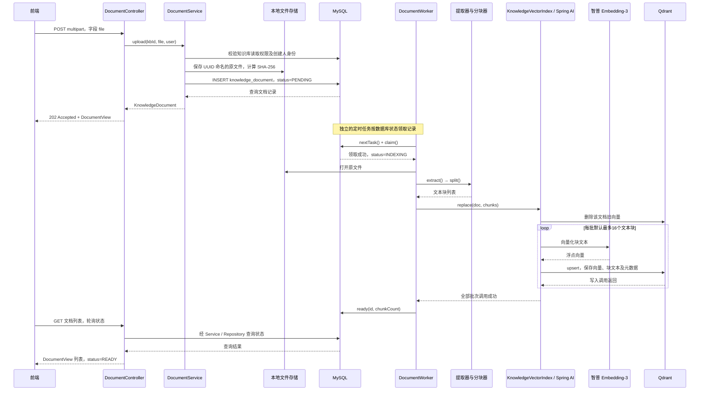
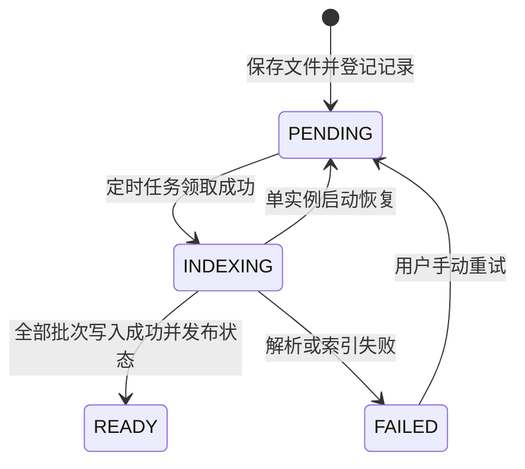

# 上传文档后的后端执行链路

本文对应当前 `backend/` 中的实际实现。入口是 `POST /api/knowledge-bases/{kbId}/documents`，请求类型为 `multipart/form-data`，文件字段名为 `file`。

上传与索引是两个独立阶段：HTTP 请求线程负责保存原文件、登记 MySQL 记录并返回；定时任务线程随后从 MySQL 领取任务，执行文字提取、分块、智普向量化和 Qdrant 写入。两者通过数据库状态交接，Controller 不直接调用 Worker，也没有使用 MQ 或 `@Async`。

## 1. 完整调用顺序

```text
HTTP 请求线程
POST /api/knowledge-bases/{kbId}/documents
  → Spring Security：校验登录身份、CSRF
  → Spring MVC：解析 multipart，将 file 绑定为 MultipartFile
  → DocumentController.upload(kbId, file, user)
    → DocumentService.upload(kbId, file, user)
      → KnowledgeBaseService.requireManage(kbId, user)
        → requireRead(kbId, user)
          → KnowledgeBaseRepository.findReadable(kbId, user)
      → UUID.randomUUID()：生成 documentId
      → LocalFileStorage.save(documentId, file)
        → 校验文件名、扩展名、非空
        → resolve(storageKey)：校验落盘路径
        → Files.copy() + DigestInputStream：写原文件并计算 SHA-256
      → DocumentRepository.insert(...)：插入 PENDING 记录
      → DocumentRepository.find(documentId)：读取文档记录
    → ApiModels.DocumentView.from(...)
  → 返回 HTTP 202 Accepted + 文档信息

================ MySQL 持久化状态交接 ================

定时任务线程
DocumentWorker.poll()
  → DocumentRepository.nextTask()：选取一个待处理任务
  → DocumentWorker.process(doc)
    → DocumentRepository.claim(...)：PENDING → INDEXING
    → LocalFileStorage.resolve(doc.storageKey())
    → DocumentTextExtractor.extract(path, originalFilename)
    → TextChunker.split(text)
    → KnowledgeVectorIndex.replace(doc, chunks)
      → delete(doc)：清理该租户、该文档的旧向量
      → 构造 List<Spring AI Document>：块 ID、原文、元数据
      → 按 embedding-batch-size 分组
      → VectorStore.add(batch)
        → Spring AI QdrantVectorStore.doAdd(batch)
          → EmbeddingModel.embed(...)
            → ZhiPuAiEmbeddingModel.call(...)
              → ZhiPuAiApi.embeddings(...)
                → 智普 embedding-3 HTTP 接口
          → QdrantClient.upsertAsync(...).get()
    → DocumentRepository.ready(id, chunkCount)：INDEXING → READY
```

`VectorStore`、`EmbeddingModel` 是框架接口；当前配置选用的实现分别是 Spring AI 的 `QdrantVectorStore` 和 `ZhiPuAiEmbeddingModel`。框架内部的调用名称按本项目 Spring AI 1.1.8 依赖核对。

## 2. 用时序图理解交接



图中 HTTP 返回和后台任务的相对顺序是常见情况，不是锁保证的顺序。`insert()` 提交后 Worker 就可能领取记录，因此上传响应里的状态也可能已是 `INDEXING`，不能依赖它一定等于 `PENDING`。

## 3. 请求阶段：具体做了什么

### 3.1 请求先经过框架校验

入口配置见 [SecurityConfig.java](../backend/src/main/java/com/example/ragassistant/config/SecurityConfig.java) 和 [application.yml](../backend/src/main/resources/application.yml)。

- 浏览器通过 `JSESSIONID` 会话 Cookie 识别身份；脚本客户端也可以使用 HTTP Basic。
- 上传属于 POST 写请求，需同时携带有效 CSRF token。
- 单文件上限为20 MB，整个 multipart 请求上限为21 MB。
- 登录或 CSRF 校验失败时，不会进入上传业务方法。multipart 超限、缺少 `file` 字段等问题也可能在 Controller 方法执行前被拒绝。

### 3.2 Controller 只转交参数和转换响应

代码：[DocumentController.upload()](../backend/src/main/java/com/example/ragassistant/web/DocumentController.java)。

```java
return ApiModels.DocumentView.from(documents.upload(kbId, file, user));
```

`user` 来自 `@AuthenticationPrincipal`，不是客户端随意传入的用户 ID。`@ResponseStatus(HttpStatus.ACCEPTED)` 指定返回202，表示已接受处理，不代表索引完成。

### 3.3 Service 校验权限并保存原文件

代码：[DocumentService.upload()](../backend/src/main/java/com/example/ragassistant/service/DocumentService.java)。

`requireManage()` 先校验同租户知识库访问权限，再要求当前用户是创建人。只有读取权限的成员不能上传文件。随后生成文档 UUID，调用 `storage.save()`。

代码：[LocalFileStorage.save()](../backend/src/main/java/com/example/ragassistant/storage/LocalFileStorage.java)。

| 项目 | 当前处理方式 |
|---|---|
| 支持格式 | pdf、doc、docx、txt、md，扩展名不区分大小写 |
| 文件名 | 去掉路径部分和控制字符，校验不超过255字符 |
| 空文件 | 拒绝保存 |
| 存储名称 | `documentId + 扩展名`，例如 `文档UUID.pdf` |
| 本机默认目录 | 以 `backend/` 为工作目录时，保存到 `backend/data/files/` |
| 文件摘要 | 写入过程中计算 SHA-256，保存到 MySQL |

此时只校验基本文件属性并落盘，不检查是否能提取出文字；一个扩展名正确的损坏 PDF 或扫描 PDF 仍可能被接收，再于后台解析阶段失败。SHA-256 当前用于记录文件摘要，没有按摘要拒绝重复上传；同一文件重复上传会获得新的 documentId。

### 3.4 MySQL 记录兼作任务

代码：[DocumentRepository.insert()](../backend/src/main/java/com/example/ragassistant/repository/DocumentRepository.java)。

写入 `knowledge_document` 的主要信息：

| 字段 | 内容 |
|---|---|
| id | 服务端生成的文档 UUID |
| knowledge_base_id / tenant_id | 所属知识库与租户 |
| original_filename / storage_key | 展示文件名与实际存储名称 |
| size_bytes / sha256 | 文件大小与摘要 |
| status | 初始值 PENDING |
| chunk_count / attempts | 初始默认值均为0 |

文件保存和数据库没有共同事务。如果 `insert()` 抛出异常，Service 会尝试删除刚保存的原文件，再向请求方抛出异常。这是补偿操作，不能覆盖进程突然退出等所有情况。

## 4. 后台阶段：从文件变成向量

### 4.1 定时器如何运行

[RagAssistantApplication.java](../backend/src/main/java/com/example/ragassistant/RagAssistantApplication.java) 使用 `@EnableScheduling` 开启调度。

[DocumentWorker.java](../backend/src/main/java/com/example/ragassistant/service/DocumentWorker.java) 在 `ApplicationReadyEvent` 时执行 `recover()`，恢复上次中断的任务，再设置 `ready=true`。`poll()` 在 ready 之前不领取任务。默认 `WORKER_ENABLED=true`。

`@Scheduled(fixedDelayString="${app.worker.poll-delay-ms:3000}")` 表示本轮方法结束后再等待约3秒执行下一轮，不是每3秒强制启动一个新任务。每轮最多领取一个任务，当前实例串行处理；如果一个文件处理很久，后面的上传文件会继续等待。

`nextTask()` 选取 `PENDING` 或 `DELETE_PENDING` 记录，删除任务优先。上传索引分支通过 `claim()` 执行带旧状态条件的更新：

```sql
UPDATE knowledge_document
SET status = 'INDEXING', attempts = attempts + 1,
    error_message = NULL, updated_at = CURRENT_TIMESTAMP(6)
WHERE id = ? AND status = 'PENDING';
```

只有更新成功才继续处理。`attempts` 在领取时增加，不是在用户点击上传或重试时增加。这仍是单应用实例方案，不具备完整的多实例租约和任务所有权机制。

### 4.2 提取文字

代码：[DocumentTextExtractor.extract()](../backend/src/main/java/com/example/ragassistant/rag/DocumentTextExtractor.java)。

| 文件格式 | 提取路径 |
|---|---|
| TXT / Markdown | `Files.readString(path, UTF_8)` |
| PDF / DOC / DOCX | Apache Tika `AutoDetectParser.parse()` |

默认提取文本上限为1,000,000字符，具体由 Java 字符串及 Tika handler 的计数限制执行，不是模型 token 上限。提取后去除 NUL、BOM 和首尾空白；不递归解析内嵌附件。

PDF 明确设置 `NO_OCR`。扫描 PDF 没有文字层时会抛出 `DocumentExtractionException`，Worker 将明确的 OCR 提示写入 `error_message`。此时尚未进入向量化，不会因为此次文字提取失败而调用智普或 DeepSeek。

### 4.3 分块

代码：[TextChunker.split()](../backend/src/main/java/com/example/ragassistant/rag/TextChunker.java)。

默认每块600个 Unicode 码点，相邻块重叠100个码点。例如，假设原文长度为1600个码点，且各块都有非空内容：

```text
chunk 0: [0, 600)
chunk 1: [500, 1100)
chunk 2: [1000, 1600)
```

返回 `Chunk(index, start, end, text)`。`end` 不包含在块内，偏移相对清洗后的提取文本，不是 PDF 页码或文件字节偏移。当前没有按章节、段落、表格或模型 token 精确切块。

### 4.4 构造 Spring AI Document

代码：[KnowledgeVectorIndex.replace()](../backend/src/main/java/com/example/ragassistant/rag/KnowledgeVectorIndex.java)。

先调用 `delete(source)`，按 `tenant_id AND document_id` 清理该文档旧向量，便于重试后重建。然后把每个 Chunk 转成框架的 `Document`，这与 MySQL 对应的 `KnowledgeDocument` 不是同一个类型：

| Java 类型 | 代表什么 |
|---|---|
| `KnowledgeDocument` | 一份上传文件的业务记录 |
| `TextChunker.Chunk` | 从清洗后的全文切出的一段文本 |
| `org.springframework.ai.document.Document` | 交给向量存储的一段文本及元数据 |

块 ID 通过 `UUID.nameUUIDFromBytes(documentId + ":" + chunkIndex)` 确定。同一文档重试时，相同块序号会生成相同 ID；同一文件重新上传得到新 documentId，因此块 ID 也会变化。

每块的元数据包含 `tenant_id`、`knowledge_base_id`、`document_id`、`filename`、`chunk_index`、`start_offset`、`end_offset`，用于后续权限过滤与来源展示。

### 4.5 智普 Embedding 与 Qdrant 写入

应用代码执行的是：

```java
store.add(documents.subList(start, end));
```

默认 `embedding-batch-size=16`。Spring AI 内部还有批处理策略，因此业务层的一批不应被理解为任何情况下都严格只发一次 HTTP 请求。

当前 `QdrantVectorStore.doAdd()` 先通过 EmbeddingModel 取得向量，再构造 Qdrant points，通过 gRPC 执行 `upsertAsync(...).get()`，等待该客户端调用返回。方法名含 Async，不表示应用立即把任务标为成功。

| 配置 | 当前默认值 / 行为 |
|---|---|
| Embedding 实现 | 智普 `ZhiPuAiEmbeddingModel` |
| 模型 | embedding-3 |
| 维度 | 2048，可被环境变量覆盖，须与 collection 匹配 |
| 实际默认 HTTP 地址 | `https://open.bigmodel.cn/api/paas/v4/embeddings` |
| 向量化输入 | 块原文；`metadata-mode=NONE`，不把权限元数据拼入文本 |
| Qdrant 连接 | 默认 gRPC 6334；不是 HTTP 6333 |
| Qdrant payload | 各元数据字段及 Spring AI 保存的 `doc_content` 块文本 |

Qdrant 不直接解析 PDF，也不替本项目调用智普。向量化请求由后端的 Spring AI 客户端发出；DeepSeek 在上传索引链路中不参与，只有后续问答生成阶段才可能调用。

### 4.6 发布 READY

全部批次成功后，Worker 调用 `DocumentRepository.ready()`：

```sql
UPDATE knowledge_document
SET status = 'READY', chunk_count = ?, updated_at = CURRENT_TIMESTAMP(6)
WHERE id = ? AND status = 'INDEXING';
```

旧状态条件避免覆盖用户处理期间发起的删除：如果状态已改成 `DELETE_PENDING`，这条 UPDATE 不会把文档变回 READY，之后由删除任务清理。

问答入口 [QuestionAnswerService.ask()](../backend/src/main/java/com/example/ragassistant/service/QuestionAnswerService.java) 会先通过 `readyIds()` 获取当前知识库的 READY 文档 ID，再按权限与这些 ID 过滤检索。部分批次写入成功、但业务状态仍是 INDEXING 或 FAILED 的文档，不会进入正常问答检索。

## 5. 失败、重试与重启恢复



这是上传相关的主要分支，完整删除状态机见[学习指南](learning-guide.md)。

| 失败位置 | 可观察到的结果 |
|---|---|
| 登录、权限、CSRF、大小或文件基本校验 | 请求被拒绝；通常不会创建文档记录 |
| 保存原文件失败 | 上传接口报错；文件保存逻辑尝试清理部分文件 |
| 插入 MySQL 失败 | 上传接口报错；Service 尝试补偿删除原文件 |
| 提取文字失败 | Worker 将状态设为 FAILED，保存预定义的文字提取提示 |
| 清理旧向量、智普调用或 Qdrant 写入失败 | Worker 将状态设为 FAILED，提示检查向量服务；原文件保留 |
| 发布 READY 失败 | 尝试记录 FAILED，提示检查 MySQL；若数据库也无法记录失败，则可能需启动恢复 |

后台异常由 Worker 捕获并写入数据库，不会回到已经结束的上传 HTTP 请求，也不走 MVC 的 `GlobalExceptionHandler`。日志记录文档 ID、状态、处理阶段和异常类型，页面不直接展示解析器或模型返回的任意原始错误。

`POST /api/documents/{id}/retry` 的链路为 `DocumentController.retry()` → `DocumentService.retry()` → `DocumentRepository.retry()`。校验管理权限后，只把 FAILED 改回 PENDING，真正重新解析仍等待 Worker。重试不复用已缓存的全文或向量；会重新读取原文件、切块和构建索引，可能再次产生模型费用。删除失败也走此入口，但改回 DELETE_PENDING。

应用启动时，`recoverInterruptedTasks()` 把 INDEXING 改回 PENDING、DELETING 改回 DELETE_PENDING，以恢复中断任务。普通 FAILED 不会自动进入重试。模型 HTTP 客户端自身的有限重试与这里的文档任务重试是两层不同机制。

## 6. 前端如何知道完成

前端 [DocumentsPage.tsx](../frontend/src/pages/DocumentsPage.tsx) 的文档列表约每3秒请求一次：

```text
GET /api/knowledge-bases/{kbId}/documents?page=0&size=20
  → DocumentController.list()
  → DocumentService.list()
  → KnowledgeBaseService.requireRead()
  → DocumentRepository.list()
  → DocumentView 列表
```

也可以用 `GET /api/documents/{id}` 查看单份文档。轮询只查询状态，不触发解析或重新索引。前端看到 READY 才展示“已就绪”；看到 FAILED 时展示 `errorMessage` 和重试入口。

交互演示模式使用浏览器中的 `DemoApi`，不经过本文任何真实后端上传链路。

## 7. 建议断点顺序

以下入口及其关联的 Repository、提取器、分块器、向量索引、文件存储、状态枚举和配置类均已补充中文源码注释，可结合本节逐步跟读。注释重点说明设计原因与异常处理，而不只是翻译方法名。

依次在下列方法设置断点，上传一份小的 UTF-8 Markdown 文件即可学习整个流程：

1. `DocumentController.upload()`：确认 kbId、MultipartFile 和 CurrentUser。
2. `DocumentService.upload()`：观察权限校验、生成 ID、落盘与登记顺序。
3. `LocalFileStorage.save()`：观察展示名称、storageKey 与实际路径的区别。
4. `DocumentRepository.insert()`：观察初始 PENDING 记录。
5. `DocumentWorker.poll()` / `process()`：切换到定时任务线程，观察 claim。
6. `DocumentTextExtractor.extract()`：检查清洗后的全文。
7. `TextChunker.split()`：检查块数量、重叠和偏移。
8. `KnowledgeVectorIndex.replace()`：检查块 ID、元数据与分批。
9. Spring AI `QdrantVectorStore.doAdd()` / `ZhiPuAiEmbeddingModel.call()`：跟踪真实向量化与写入。
10. `DocumentRepository.ready()`：确认只有成功后才发布 READY。

调试时注意 HTTP 请求线程与定时任务线程不同。IDE 的“暂停所有线程”可能同时阻塞上传、轮询和后台任务；在断点处长时间停留也可能造成客户端或模型请求超时。查看变量时不要把 API Key、Cookie 或文档敏感内容复制到公开日志。
