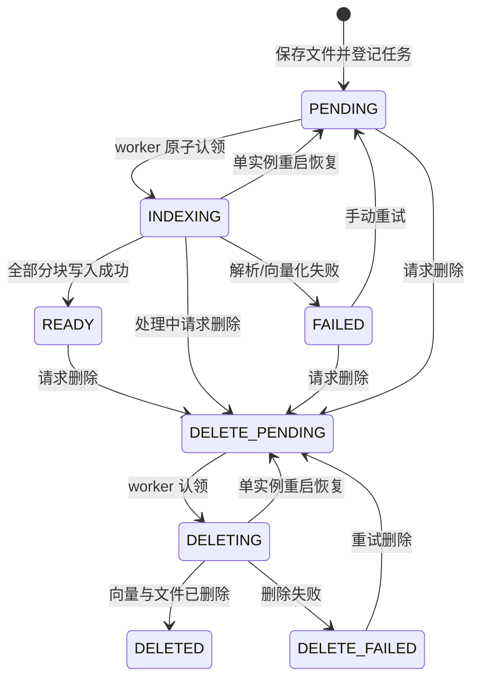

# 从业务接口读懂 Java RAG

上传入库的逐方法调用顺序、时序图和断点位置见[上传文档执行链路](document-upload-flow.md)。

## 一、RAG 并没有重新训练模型

上传文档后，系统提取文字并切成小块，通过 Embedding 模型得到浮点向量。Qdrant 保存向量、文本块和元数据。提问时，把问题也转成向量，找相近的块，再把这些块和问题一起交给聊天模型。

因此有两条独立路径：

```text
离线 / 后台：文件 → 提取文字 → 分块 → Embedding → Qdrant
在线 / 问答：问题 → 权限校验 → Embedding → 向量检索 → 提示词 → 聊天模型 → 答案与来源
```

`KnowledgeVectorIndex` 注入的是 Spring AI `VectorStore`。它的 `add(documents)` 已经会调用配置的 `EmbeddingModel`，不需要先手工生成向量再调用一次 add。问题向量化也发生在 `similaritySearch()` 内部。

本工程把 `spring.ai.model.embedding` 设置为 `zhipuai`，把 `spring.ai.model.chat` 设置为 `deepseek`，并关闭 image 自动配置。因此向量写入与查询都使用智普 Embedding-3，生成答案使用 DeepSeek，两个客户端分别读取自己的 API Key。不要仅引入两个 starter 而省略供应商选择，否则可能同时创建两个 ChatModel。

智普使用 Spring AI 原生 `ZhiPuAiEmbeddingModel`，显式设置 `dimensions=2048`、`metadata-mode=NONE`。后者表示只向量化文档原文，tenant_id 等仍存入 Qdrant payload 用于过滤，但不拼接到 Embedding 输入。DeepSeek 使用原生 `DeepSeekChatModel`，业务层仍然面向 `ChatModel` 接口，所以 `AnswerGenerator` 不需要绑定厂商 SDK。

URL 需要特别留意：智普配置的 base-url 是 `https://open.bigmodel.cn/api/paas`，客户端追加 `/v4/embeddings`；DeepSeek base-url 是 `https://api.deepseek.com`，客户端追加 `/chat/completions`。`CloudModelConfigurationTest` 会实际验证这些 HTTP 请求以及两个密钥没有混用。

## 二、为什么 MySQL 与 Qdrant 都要保留

MySQL 保存业务事实：用户是谁、属于哪个租户、谁能读哪个知识库、文档是否处理成功。Qdrant 保存可重建的检索索引。

| 数据 | 所在位置 | 示例 |
|---|---|---|
| 用户与密码散列 | MySQL app_user | tenant_id、username、password_hash |
| 知识库与权限 | MySQL knowledge_base / knowledge_member | owner_id、成员关系 |
| 文件与处理状态 | MySQL knowledge_document | storage_key、status、attempts |
| 访问审计 | MySQL question_audit | 访问人、知识库、来源 ID、结果状态 |
| 文件本体 | 文件系统 | 服务端 UUID 命名的 PDF / Word |
| 文本块与向量 | Qdrant collection | 向量、doc_content、元数据 |

Qdrant 中的 metadata 实际存放在 point 的 payload 中：

```json
{
  "tenant_id": "demo-company",
  "knowledge_base_id": "由服务器生成的知识库 UUID",
  "document_id": "由服务器生成的文档 UUID",
  "filename": "employee-handbook.md",
  "chunk_index": 0,
  "start_offset": 0,
  "end_offset": 600
}
```

Spring AI 额外使用 `doc_content` 保存块文本。`start_offset` / `end_offset` 统计 Unicode 码点，`chunk_index` 从 0 开始；回答中的来源编号 `[1]` 则从 1 开始，它们不是同一个编号。

## 三、分块为什么需要重叠

假设每块 600 个码点、重叠 100 个：

```text
块 0：[0, 600)
块 1：[500, 1100)
块 2：[1000, 1600)
```

“住宿费用超过上限时”与“需取得负责人书面批准”可能落在边界两侧。适当重叠可以保留关联。但重叠过大会浪费存储，并让 Top-K 都是重复内容。

本工程使用易读的固定滑窗，尚未使用标题、段落、表格或 token 感知策略。学习时可先调节 `chunk-size` 与 `chunk-overlap`，观察不同问题的来源变化。

## 四、状态机比一个 @Async 方法更重要



READY 是唯一可参与问答的状态。向量可能只写入了一半，但 MySQL 尚未 READY，这些半成品不会被问答检索到。

用户可能在向量写入过程中请求删除。因此 `DocumentRepository.ready()` 使用：

```sql
UPDATE knowledge_document
SET status = 'READY', chunk_count = ?
WHERE id = ? AND status = 'INDEXING';
```

如果状态已变成 DELETE_PENDING，这条 UPDATE 影响 0 行，不能把删除请求覆盖掉。

每个块的 point ID 由 `documentId + chunkIndex` 生成确定性 UUID；重试前先按 document_id 清理旧块，再批量写入。不要把 MySQL 事务长时间挂在模型请求上，事务既不能回滚 Qdrant，也会持续占用数据库连接和锁。

当前 worker 是单实例设计，自动恢复处理中状态只在这个约束下成立。未来扩展到多实例，应增加有超时时间的租约、任务所有者和续租机制，或引入消息队列 / Outbox。

## 五、权限如何进入检索

1. Spring Security 验证用户名和密码，构造 `CurrentUser`。
2. MySQL 校验用户属于当前租户，且是知识库创建人或成员。
3. 查询当前知识库内的 READY 文档 ID。
4. 用结构化过滤表达式检索 Qdrant：tenant_id 相等 AND knowledge_base_id 相等 AND document_id 在 READY 集合。
5. 检索后、返回前再次校验权限与文档状态。

不接受客户端自由指定 tenantId，不开放任意过滤表达式，不把“先全库取 Top-K 再过滤权限”作为主方案。

撤权只更新 MySQL 成员关系即可：权限检查每次从 MySQL 读取，未把成员列表复制进 Qdrant。但正在执行的请求存在通常的并发时间窗口；如果企业需要严格的撤权线性化语义，需要更强的请求版本/锁定方案。

## 六、如何判断回答是否可靠

相似度分数表示向量相关性，不是回答正确率。`0.9` 不能解读为“答案有 90% 概率正确”。

模型收到的内容分为 system message 与 user message：系统规则要求只依赖证据、拒绝编造，并将参考资料视为数据。输入使用消息对象直接拼装，原文中的 `{}` 不会误触发模板替换。

`sources` 返回的是实际交给模型的资料。它便于人核对，但不是自动事实核验结果。当前没有逐句检查引用编号或判断每一句答案是否被原文支持。

学习时建议建立一个小评测表：

| 问题 | 预期依据 | 期望行为 |
|---|---|---|
| 出差住宿上限是多少？ | 差旅住宿章节 | 回答 500 元并引用原文 |
| 报销需要哪些材料？ | 同上 | 发票与出差审批单 |
| 年假需要提前多久申请？ | 请假流程章节 | 至少提前 3 个工作日 |
| 今年奖金发多少？ | 无 | 明确资料不足，不编造 |
| 无权限的 bob 查询 alice 的知识库 | 无 | 返回 404，不调用模型 |

先检查正确段落是否被检索到，再调整生成提示词。找不到正确证据时，单纯换更强的聊天模型通常不能解决根因。

## 七、逐步扩展练习

1. 把 TextChunker 改成段落优先，并比较来源完整性。
2. 对检索候选做去重，再增加 Reranker；不要把余弦相似度和重排分数直接混为一谈。
3. 加入关键词检索并进行结果融合，测试错误码、设备型号等问题。
4. 将 LocalFileStorage 抽成接口，增加 MinIO 实现和文件生命周期管理。
5. 增加文档版本与全库重建任务，支持安全切换 Embedding 模型。
6. 通过 OIDC 接入企业身份系统，增加文档级权限与租约任务队列。
